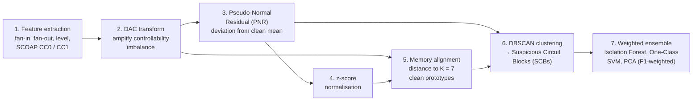

# Unsupervised Pre-Silicon Hardware Trojan Detection

**Difference Amplified Controllability and Memory Alignment Based Hardware Trojan Detection Using Unsupervised Ensemble Algorithm**
Shruddha Metri, Nirmala Devi M — PES University, Bengaluru
*2026 Control Instrumentation Systems Conference (CISCON), IEEE*
📄 Paper: [doi.org/10.1109/CISCON71603.2026.11709298](https://doi.org/10.1109/CISCON71603.2026.11709298)

---

## The problem

A **hardware Trojan** is hidden malicious logic inserted into a chip during design or
fabrication, by an untrusted foundry, IP vendor or EDA tool. It has a **trigger** (a rare
condition that keeps it dormant during normal testing) and a **payload** (data leakage,
wrong function, or denial of service once triggered). Unlike software, it cannot be patched
after the chip is made.

Detecting Trojans is hard because:
- **labelled Trojan data is extremely rare**, so supervised machine learning is impractical;
- Trojans are designed to **look like normal logic**;
- existing unsupervised methods give **many false positives or miss Trojan gates**.

## The approach

A **fully unsupervised, pre-silicon** framework that works on the **gate-level netlist**
before tape-out, without labelled Trojan data and without a fabricated golden chip
(a Trojan-free netlist serves as the reference for normal behaviour). Seven stages:



| Stage | Idea |
|---|---|
| **Difference Amplified Controllability (DAC)** | Trojan trigger gates are hard to control to one value, but their raw CC0/CC1 values differ only slightly from normal gates. A non-linear transform amplifies that imbalance so Trojan gates stand out. |
| **Pseudo-Normal Residual (PNR)** | Learns the expected DAC behaviour from a clean circuit and flags gates whose residual from it is large. Catches strong single-feature anomalies. |
| **Memory alignment** | Stores K = 7 prototypes of clean gates (k-means) and flags gates far from all of them (prototype and Mahalanobis distance). Catches *multi-feature* anomalies that PNR misses. |
| **DBSCAN + Suspicious Circuit Blocks** | Trojans are small blocks of gates, not single gates, so abnormal gates are grouped by density into SCBs. This localises the Trojan region. |
| **Ensemble** | Several unsupervised detectors are combined with weights proportional to their F1 score, so no single model's weakness dominates. |

## Results

Evaluated on **ten Trust-Hub benchmark circuits**: S38417, S35932 and S38584 (Trojan
variants T100, T200, T300) and S15850 T100, covering mixed and sequential-dominant designs.

**Combined multi-circuit dataset, final ensemble:**

| Metric | Value |
|---|---|
| F1 score | **80.23 %** |
| Precision | 67.09 % |
| Recall | **99.77 %** (19 Trojan gates missed out of 8,248) |

**Compared with the prior unsupervised methods cited in the paper:**

| Method | F1 | Precision | Recall |
|---|---|---|---|
| PCA + LOF (PL-HTD) | 33.56 % | 34.56 % | 42.2 % |
| LOF + CBLOF ensemble | 45.89 % | 38.70 % | 56.44 % |
| **This work** | **80.23 %** | **67.09 %** | **99.77 %** |

**Key findings**
- DAC amplification makes Trojan and normal gates clearly separable across all circuit families.
- PNR and memory alignment are **complementary**: on S38417 T200 they flagged 268 and 565 gates of the Trojan-inserted circuit respectively, with no overlap.
- Training on the **combined** dataset generalises better than per-circuit models, with more stable F1 across structurally different circuits.
- LOF was over-sensitive on structurally similar gates; removing it from the ensemble raised F1 substantially.

## My contribution

- Designed and implemented the full seven-stage detection pipeline
- Feature extraction (structural + SCOAP testability) from gate-level netlists
- DAC, PNR and memory-alignment modules; DBSCAN-based SCB partitioning; weighted ensemble
- Experiments, sensitivity analysis (K, DBSCAN ε) and evaluation on ten Trust-Hub benchmarks
- Paper writing, under the guidance of Dr. Nirmala Devi M

**Tools:** Python, Google Colab, PyVerilog, Icarus Verilog, NetworkX, pandas, NumPy, scikit-learn, SciPy, Matplotlib.

## Code availability

The source code is not public. The method, equations and full results are described in the
paper linked above.

## Citation

```bibtex
@inproceedings{metri2026hardwaretrojan,
  author    = {Metri, Shruddha and Nirmala Devi, M.},
  title     = {Difference Amplified Controllability and Memory Alignment Based
               Hardware Trojan Detection Using Unsupervised Ensemble Algorithm},
  booktitle = {2026 Control Instrumentation Systems Conference (CISCON)},
  publisher = {IEEE},
  year      = {2026},
  doi       = {10.1109/CISCON71603.2026.11709298}
}
```
